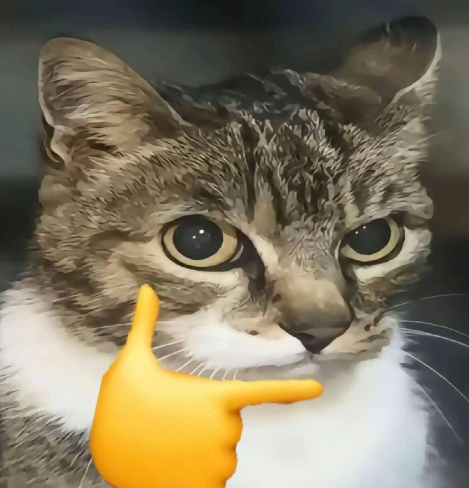

# 劉品諴的個人網頁

  

## 1. 基本資料 / Basic Information

| 項目 | 內容 |
| :--- | :--- |
| **姓名 / Name** | 劉品諴 |
| **系級 / Department & Year** | 生命科學暨生物科技學系一年級 |
| **學校 / University** | 國立臺灣海洋大學 |
| **家鄉 / Hometown** | 桃園 |
| **Email** | `0153B042@student.com` |
| **GitHub** | [xianxian718](https://github.com/xianxian718) |

---

## 2. 關於我 / About Me

大家好，我是劉品諴，目前就讀臺灣海洋大學生命科學暨生物科技學系一年級。我對生命科學、電腦與人工智慧很有興趣。進入大學後，我希望除了學習專業知識之外，也能培養程式設計、資料分析與解決問題的能力。

---

## 3. 我的興趣 / Interests

* 🏀 **運動**：健身、撞球
* 🎵 **音樂**：流行音樂
* 🎮 **休閒**：遊戲、電影
* 💻 **學習**：Python、AI、生物資訊

---

## 4. 我的學習與技能 / Skills

| 技能 | 目前程度 | 我會做什麼 |
| :--- | :--- | :--- |
| **Python** | 初學 | 變數、if 條件句、for 迴圈、function 函數 |
| **GitHub** | 初學 | 建立 Repository、commit、push |
| **英文** | 中等 | 閱讀英文教材 |

---

## 5. 我的小作品 / Projects

### Project 1 ｜ 我的第一個 Python 程式
* **簡介**：這是我在課堂中完成的第一個 Python 小作品。我學會如何使用變數、輸入資料，以及將結果顯示在畫面上。
* **GitHub 連結**：[查看專案](https://github.com/xianxian718)

### Project 2 ｜ 敬請期待
* **作品內容**：*（施工中 / 規劃中）*
* **GitHub 連結**：-

---

## 6. 我的學習目標 / Goals

- [ ] 學會 Python 基礎程式設計。
- [ ] 學會使用 Git 與 GitHub 管理自己的作品。
- [ ] 建立自己的第一個個人網站。
- [ ] 未來能將程式設計應用在自己的專業領域。

---

## 7. 聯絡我 / Contact

* **Email**：`0153B042@student.com`
* **GitHub**：[@xianxian718](https://github.com/xianxian718)

---

## 8. 給未來的自己 / A Note to My Future Self

> 希望一年後回來看這個網頁時，我已經學會更多程式設計技巧，也完成更多自己的作品。
> 
> *Of course, to the Danger Zone.*
